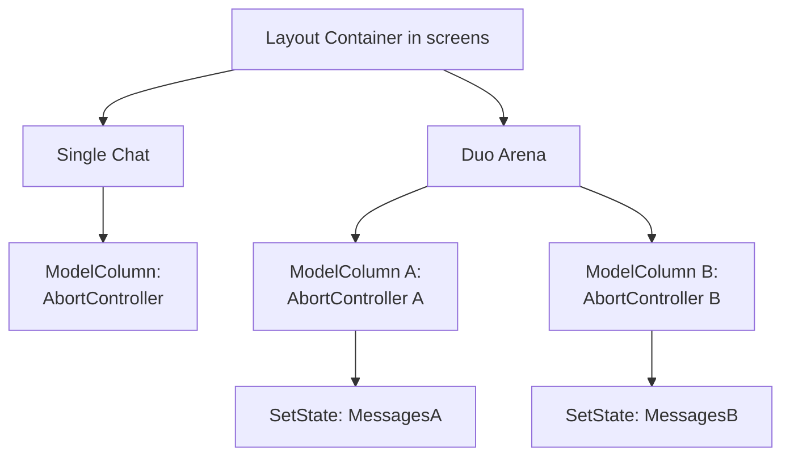

### Overview
Refactor Chatbox to modulized components in order to support creating Duo-Arena for comparing models performance.

### System Architecture

### Key Refactoring Goals
#### 1. Component Extraction (ModelColumn)
- Modulize message stream in UI: messages feed, auto-scroll behaviour, token counter and stop generating button
#### 2. State elevation (Duo Arena)
- Bring state of Input (where user input chat message) out to SharedInputForm to allow API calls simutaneously
- state of messages, isGenerating, aborController and bufferRef is attached with ModelColumn
